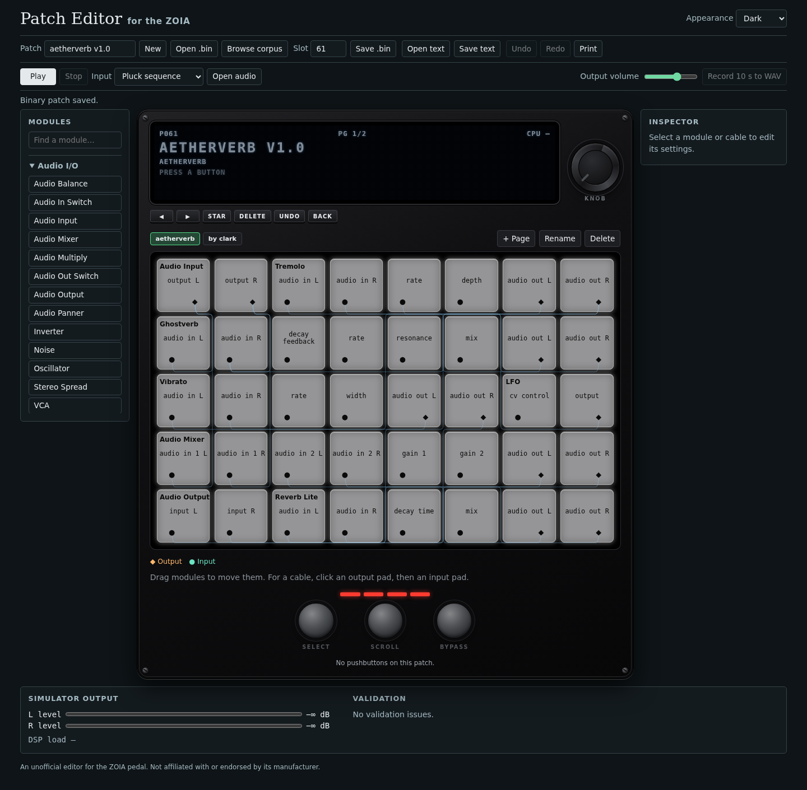

# Patch Editor for the ZOIA

This is an unofficial, browser-based patch editor for the ZOIA pedal. It is not affiliated with, endorsed by or supported by the manufacturer.

**Try it in your browser:** https://michaelaperry.github.io/zoia-editor/

**Download:** get `editor/dist/zoia-editor.html` and open it. Nothing to install.



## Look and feel
- Drawn like the pedal: black enclosure, 8 x 5 grid of buttons lit in module colours.
- OLED-style display, a knob, utility keys and three footswitches (SELECT, SCROLL, BYPASS).
- Follows your light/dark setting while the pedal stays black.

## Works offline
- Runs as one HTML file. Double-click to start.
- Playback needs AudioWorklet.
- The patch library needs DecompressionStream. Tested in Chrome/Chromium. Edge is likely to work. Firefox and Safari are untested.

## Features
- Opens and saves ZOIA `.bin` patches with a byte-exact round trip.
- Plain-text patch format supported.
- Place modules on the grid and cable them.
- Edit options, colours, names and pages.
- Turn the knob with the scroll wheel, a drag or the arrow keys. Hold Shift for fine adjustments.
- The display shows module, parameter and value.
- Plays the patch through a built-in simulator.
- Input sources: pluck, drum, click, noise, file or live input.
- Records 10 s to WAV.
- Browses an embedded patch library.
- Autosaves in the browser.
- Prints patch sheets.

## Rebuild for development
Requires Python 3 only.
```bash
python3 editor/build_single.py
```
Dev server:
```bash
./editor/serve.sh
```
Then open http://localhost:8280/editor/.

## Tests (run with Node 26, no packages)
```bash
node --test --test-isolation=none editor/tests/*.test.js
node --test --test-isolation=none --test-skip-pattern='every module-supported corpus patch' sim/tests/*.mjs
python3 -B -m unittest discover -s tests
```
Click-through in headless Chromium:
```bash
node tools/cdp-clickthrough.mjs "$PWD/editor/dist/zoia-editor.html" "$PWD/screenshots" /tmp/zoia-downloads
```
Set the `CHROME` environment variable to a Chromium binary. It always launches muted.

## Layout
- `editor/`: editor core, UI, style, build scripts and tests.
- `zoiacodec/`: Python reference codec for `.bin` files.
- `sim/`: JavaScript DSP simulator for playback.
- `corpus/`: community patches for the library and tests.
- `out/`: the author's own bench patches.
- `tools/`: click-through and corpus scripts.
- `screenshots/`: output of the click-through.
- `RECON.md`: binary format notes.

## Patch library
The embedded library contains only patches whose authors published them on PatchStorage under an open licence (Creative Commons, WTFPL, GPL, Unlicense), plus one empty patch.
- Each patch keeps its author's own licence, not GPL.
- Titles, authors, licences and links are in [corpus/LICENSES.md](corpus/LICENSES.md).
- If you are an author and want your patch removed, open an issue.

## Status
This is a hobby project. The simulator is an approximation of the pedal. See [CALIBRATION.md](CALIBRATION.md) for measurements against the pedal. Bug reports welcome via issues.

## Licence and credits
Code is under GPL-3.0 (see `LICENSE`).
- Patch format and module data from [zoia_lib](https://github.com/meanmedianmoge/zoia_lib) by meanmedianmoge (GPL-3.0).
- Format decoded by djigneo/apparent1.
- Encoder work by Sranderley.
- See `HISTORY.md` for more details.
- Written by AI coding agents (Codex, Claude) under review, for Michael Perry.
